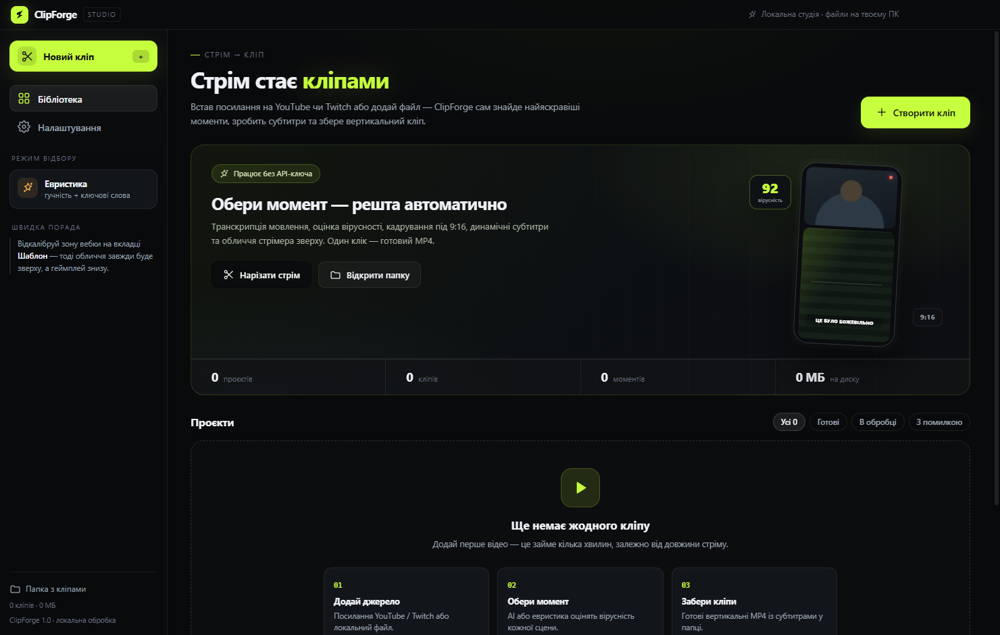
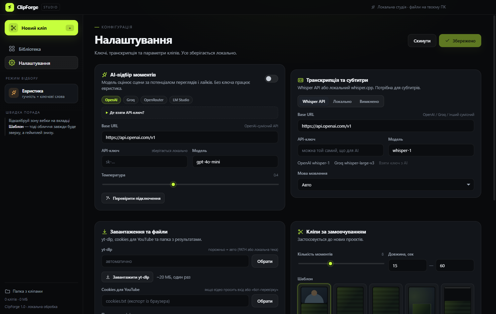

# ClipForge

Десктопна студія для нарізки стрімів у вертикальні кліпи. Вставляєш посилання на YouTube/Twitch
(або обираєш локальний файл) — застосунок сам знаходить найтепліші моменти, робить субтитри й
збирає готові MP4 із вебкою стрімера зверху та геймплеєм знизу.



## Що вміє

- **Джерела:** YouTube, Twitch, будь-який локальний відеофайл.
- **Пошук моментів:** евристика (гучність, ключові слова, пунктуація) або AI-модель із поясненням
  оцінки. Кожен момент має бал і причину, його можна підправити вручну.
- **Субтитри:** Whisper API (OpenAI/Groq), локальний whisper.cpp, імпорт SRT/VTT. Стилі — жирний,
  плашка, караоке (підсвітка слів), мінімал.
- **Шаблони:** обличчя зверху, обличчя знизу, вебка в куті, тільки геймплей 9:16, горизонталь 16:9.
  Зони вебки та геймплею калібруються мишкою на реальному кадрі.
- **Рендер:** 1080×1920 (або 1920×1080) H.264/AAC, нормалізація гучності −14 LUFS, faststart.
- **Локально:** ffmpeg вбудований, проєкти й ключі зберігаються на диску. Хмара — лише якщо сам
  увімкнеш AI/Whisper API.

## Як запустити

### На цьому комп’ютері

На **Робочому столі** є ярлик **ClipForge** — просто двічі клікни. Він запускає Electron із папки
проєкту:

```
C:\Users\stasb\OneDrive\Документи\Типовий проєкт
```

Папку не перейменовуй і не переноси, інакше ярлик зламається. Якщо оновлював код — виконай
`npm run build`, ярлик підхопить свіжий білд.

### Вручну

```bash
npm install        # один раз, підтягує Electron, ffmpeg, ffprobe
npm run build      # збирає out/ (main, preload, renderer)
npm run dev        # режим розробки з гарячим перезавантаженням
```

Запуск зібраної версії без ярлика:

```bash
node_modules\electron\dist\electron.exe .
```

### Інсталятор

```bash
npm run dist
```

Готовий інсталятор лежить у `release\ClipForge Setup 1.0.0.exe`. Він **не підписаний**, тому Windows
Smart App Control може його заблокувати (на цьому ПК увімкнений режим перевірки невідомих програм —
саме тому робочий ярлик запускає Electron із папки проєкту). Для інших ПК інсталятор цілком робочий.

---

## Як підключити API-ключі

Ключі не обов’язкові. Без них працює евристичний пошук моментів, але **субтитрів не буде**.
Є два незалежні налаштування:

| Що | Навіщо | Де ввімкнути |
| --- | --- | --- |
| **AI-відбір моментів** | Модель оцінює сцени за потенціалом переглядів/лайків | Налаштування → AI-відбір моментів |
| **Whisper API** | Транскрипція мовлення для субтитрів | Налаштування → Транскрипція та субтитри |

Один ключ Groq або OpenAI підходить для обох.

### Крок за кроком (AI-відбір)

1. Відкрий **Налаштування → AI-відбір моментів** і ввімкни перемикач.
2. Обери провайдера чипом: **OpenAI**, **Groq**, **OpenRouter** або **LM Studio**.
3. Відкрий консоль провайдера, створи ключ і скопіюй його (показується один раз):

   | Провайдер | Сторінка ключів | Base URL | Модель |
   | --- | --- | --- | --- |
   | OpenAI | https://platform.openai.com/api-keys | `https://api.openai.com/v1` | `gpt-4o-mini` |
   | Groq (безкоштовний ліміт) | https://console.groq.com/keys | `https://api.groq.com/openai/v1` | `llama-3.3-70b-versatile` |
   | OpenRouter | https://openrouter.ai/settings/keys | `https://openrouter.ai/api/v1` | `openai/gpt-4o-mini` |
   | LM Studio (локально) | ключ не потрібен | `http://localhost:1234/v1` | id моделі з LM Studio |

4. Встав ключ у поле **API-ключ**, перевір **Base URL** і **Модель**.
5. Натисни **«Перевірити підключення»** — має з’явитися зелене підтвердження.
6. Натисни **«Зберегти зміни»**.

Ті самі посилання є в застосунку: розкрий блок **«Де взяти API-ключ?»** під чипами провайдерів.

### Крок за кроком (субтитри Whisper)

1. **Налаштування → Транскрипція та субтитри**, режим **Whisper API**.
2. Обери провайдера кнопкою внизу:
   - **OpenAI** → Base URL `https://api.openai.com/v1`, модель `whisper-1`;
   - **Groq** → Base URL `https://api.groq.com/openai/v1`, модель `whisper-large-v3`.
3. Встав ключ. Якщо ключ уже введений для AI — натисни **«Взяти ключ з AI»**.
4. **Мова мовлення**: `Українська` або `Авто`.
5. Збережи. Транскрипція запускається разом із новим проєктом; можна перезапустити її на вкладці
   **Транскрипт**.

> Довгі стріми ріжуться на шматки по 10 хвилин (ліміт API — 25 МБ на файл). Хмарна транскрипція
> 2-годинного стріму коштує гроші — орієнтуйся на тарифи провайдера. Для великих обсягів краще
> локальний whisper.cpp.

### Де зберігаються ключі

- Файл: `%APPDATA%\clipforge\clipforge.json` (звичайний текст, **не** зашифрований).
- Ключі нікуди не надсилаються, крім обраного API. Синхронізація OneDrive цього файлу не стосується —
  він лежить поза папкою проєкту.
- Щоб вимкнути доступ — очисти поле ключа й збережи. Не публікуй цей файл і не ділись ключем.

### Без ключів

- **AI-відбір** вимкнений → моменти шукаються евристикою (гучність + ключові слова).
  Це безкоштовно і працює офлайн.
- **Локальні субтитри:** встанови [whisper.cpp](https://github.com/ggml-org/whisper.cpp/releases)
  (Windows x64), завантаж модель `ggml-small.bin` або `ggml-medium.bin` (Hugging Face
  `ggerganov/whisper.cpp`), у налаштуваннях вибери режим **Локально** і вкажи шляхи до
  `whisper-cli.exe` та `.bin`. Далі все працює без інтернету.
- **LM Studio:** запусти локальний сервер (Developer → Start Server), Base URL
  `http://localhost:1234/v1`, модель — id із вкладки моделей. Ключ можна залишити порожнім.

---

## Робочий процес

1. **Новий кліп** → встав посилання або обери файл → задай кількість/довжину моментів → **Аналізувати**.
2. **Моменти** → обери найкращі, підправ межі, додай свої (кнопка «+» на таймлайні).
3. **Шаблон** → вибери розкладку, відкалібруй зони вебки/геймплею на кадрі, налаштуй субтитри,
   зроби **Прев’ю**.
4. **Кліпи** → **Рендер** вибраних моментів. Готові файли — у папці з налаштувань
   (типово `C:\Users\<ти>\Videos\ClipForge`).
5. **Транскрипт** → імпорт SRT/VTT або повторна транскрипція.



### Поради щодо шаблонів

- **Обличчя зверху / знизу** — класика TikTok/Reels: вебка 1080×640, геймплей 1080×1280.
- **Вебка в куті** — геймплей на весь екран, обличчя поверх у куточку.
- **Тільки геймплей 9:16** — блюр-фон навколо центрального кадру (для мобільних стрімів).
- **Горизонталь** — для YouTube та довших форматів.
- Калібрування: потягни рамку на кадрі; рамка вебки має охоплювати лише обличчя, рамка геймплею —
  корисну частину екрана. Перевіряй **Прев’ю** перед рендером.

---

## Типові проблеми

**YouTube просить вхід / «Sign in to confirm you’re not a bot».**
Експортуй cookies браузера у формат Netscape (`cookies.txt`) і вкажи файл у
**Налаштування → Cookies для YouTube**. Додаток також може оновити yt-dlp кнопкою
**«Завантажити yt-dlp»**. Twitch зазвичай працює без cookies.

**Кліпи без субтитрів.**
Перевір режим транскрипції та ключ; подивись крок **Транскрипція** в проєкті (там буде причина).
Якщо ключа немає — транскрипція пропускається, рендер іде далі. Імпортувати готовий SRT можна на
вкладці **Транскрипт**.

**«Перевірити підключення» не проходить.**
Base URL має закінчуватися на `/v1`; ключ без пробілів; модель існує в провайдера; для OpenRouter
модель пишеться як `vendor/model`. Помилка 429 — вичерпано ліміт, зачекай або зміни провайдера.

**Smart App Control блокує ClipForge.exe.**
Інсталятор і exe не підписані. На цьому ПК використовуй ярлик з Робочого столу (він запускає
підписаний `electron.exe` із папки проєкту). На іншому ПК можна вимкнути перевірку або підписати
збірку сертифікатом code signing.

**Повільний рендер.**
Кодування H.264 йде через CPU. Довгі кліпи з 4K-джерела обробляються довше; зменш кількість
моментів або довжину. Не закривай вікно під час рендеру.

---

## Розробка

**Стек:** Electron 45, React 19, TypeScript, Vite/electron-vite. FFmpeg і ffprobe — через
`ffmpeg-static`/`ffprobe-static`. Завантаження — `yt-dlp.exe` (авто-завантаження в
`%APPDATA%\clipforge\bin`).

```bash
npm run typecheck   # перевірка типів main + renderer
npm run build       # production-збірка в out/
npm run smoke       # наскрізний тест ядра: 5 шаблонів, субтитри, рендер
npm run dist        # NSIS-інсталятор у release/
```

Корисні файли:

- `src/main/core/pipeline.ts` — оркестрація: завантаження → аналіз → транскрипція → пошук моментів.
- `src/main/core/render/render.ts` — фільтри FFmpeg для всіх шаблонів, прев’ю.
- `src/main/core/render/ass.ts` — генерація ASS-субтитрів (караоке, плашка, жирний).
- `src/main/core/analyze.ts` — евристика та AI-промпт.
- `src/main/core/transcribe.ts` — Whisper API, локальний whisper.cpp, SRT/VTT.
- `src/renderer/src/components/LayoutTab.tsx` — редактор зон і налаштування субтитрів.

Іконка застосунку генерується скриптом:

```bash
python scripts/make-icon.py   # build/icon.png + build/icon.ico
```

### Де що лежить

| Що | Шлях |
| --- | --- |
| Налаштування, ключі, проєкти | `%APPDATA%\clipforge\clipforge.json` |
| Робочі файли проєкту | `%APPDATA%\clipforge\work\<jobId>` |
| Типові кліпи | `%USERPROFILE%\Videos\ClipForge` |
| yt-dlp | `%APPDATA%\clipforge\bin\yt-dlp.exe` |

## Ліцензії

Код проєкту — MIT. FFmpeg збирається пакетом `ffmpeg-static` під GPL; якщо розповсюджуєш збірку
публічно, дотримуйся умов ліцензії FFmpeg і вкажи джерело.
